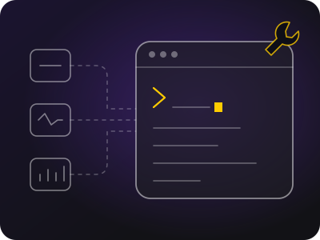

# TrueNAS homelab toolkit

<p align="center"></p>

🇬🇧 [English](README.md) · 🇮🇹 **Italiano**

**Piccoli script indipendenti per far girare TrueNAS a casa.** Tieni i pannelli di amministrazione fuori dalla rete di casa, ricevi un avviso quando è il NAS stesso a spegnersi, metti salute dei pool e backup in una dashboard, e fai backup notturni che si dimostrano ripristinabili. Nati in un homelab dove girano tutti i giorni.

[](https://github.com/EmaLau/truenas-homelab-toolkit/actions/workflows/ci.yml)
[](LICENSE)


| Script | Cosa fa | Quando gira |
|---|---|---|
| [`lan-guard`](#lan-guard) | Blocca dalla rete di casa le porte delle app riservate all'amministrazione (IPv4 e IPv6), senza toccare SSH, l'interfaccia web o la VPN | all'avvio e ogni 5 minuti |
| [`heartbeat`](#heartbeat) | Manda un segnale a un servizio esterno, così sai quando il NAS è spento; fa i tuoi controlli e avvisa su ntfy o un webhook | ogni minuto |
| [`storage-status`](#storage-status) | Salute e spazio dei pool, scrub, errori dei dischi, spazio del cloud, esito dei cloud sync e snapshot in un file JSON, o come metriche Prometheus | ogni 30 minuti |
| [`system-backup`](#system-backup) | Configurazione di TrueNAS, impostazioni delle app, database PostgreSQL e MariaDB e cartelle delle app, con checksum, conservazione e uno script di verifica che ripristina i database | ogni notte |

La guida completa, con tutte le impostazioni, come funziona ogni script, il ripristino di un backup e i problemi comuni, è la **[documentazione](docs/documentazione.md)**.

## Installazione

Gli script girano come root su TrueNAS (provati sulla 25.10). Clona il repository su un **pool di dati** (il pool di avvio viene sostituito a ogni aggiornamento), crea i file di impostazioni degli script che vuoi partendo dagli esempi, poi lascia che `install.sh` crei i cron job e lo script di avvio tramite il middleware di TrueNAS:

```bash
git clone https://github.com/EmaLau/truenas-homelab-toolkit.git /mnt/tank/toolkit
cd /mnt/tank/toolkit
cp lan-guard/lan-guard.conf.example lan-guard/lan-guard.conf    # e così via, poi modificali
./install.sh --dry-run      # mostra cosa verrebbe creato
./install.sh                # crea o aggiorna i job
```

`install.sh` riconosce i suoi job, quindi se lo rilanci (dopo un aggiornamento o dopo aver spostato la cartella) li aggiorna invece di aggiungerne delle copie; segnala i job che hai fatto a mano per gli stessi script, che altrimenti girerebbero due volte. `--disabled` crea i job spenti, `--uninstall` li toglie. Le impostazioni comuni a più script (notifiche, Uptime Kuma) si possono scrivere una volta sola in `toolkit.conf`. Dettagli: [Installazione](docs/documentazione.md#installazione).

## lan-guard

Docker apre le porte delle app a tutti i dispositivi della rete di casa, e una normale regola del firewall non lo ferma: Docker riscrive la destinazione prima che `INPUT` veda il pacchetto. `lan-guard.sh` scarta le connessioni nuove che arrivano dall'interfaccia della rete di casa verso le porte che elenchi, nella catena `DOCKER-USER`, riconoscendo la porta originale con conntrack. Il traffico della VPN, SSH e l'interfaccia di TrueNAS non vengono toccati, quindi non puoi chiuderti fuori.

```bash
lan-guard.sh dry-run   # stampa le regole, senza cambiare niente
lan-guard.sh           # applica (si può ripetere)
lan-guard.sh status    # regole e contatori
lan-guard.sh off       # toglie tutto
```

Facoltativi: indirizzi della rete di casa ammessi comunque su una porta (`ALLOW`) e log delle connessioni bloccate, con un limite. Avvisa se l'interfaccia non esiste o se Docker non passa più da `DOCKER-USER`. Solo TCP. [Altro](docs/documentazione.md#lan-guard).

## heartbeat

Un monitoraggio che gira sul NAS non può dirti che il NAS è spento. `heartbeat.sh` rovescia il controllo: ogni minuto manda un segnale a [Healthchecks](https://healthchecks.io) o a un altro servizio di heartbeat, che ti avvisa da fuori quando i segnali smettono di arrivare. Può anche inviare a Uptime Kuma lo stato di Tailscale e i tuoi controlli (qualsiasi comando: codice di uscita 0 vuol dire su), e mandare un messaggio a ntfy o a un webhook quando un controllo va giù o torna su. [Altro](docs/documentazione.md#heartbeat).

## storage-status

Raccoglie, come root, quello che l'interfaccia di TrueNAS sparpaglia su più pagine: stato, spazio e salute dei pool, l'ultimo scrub o resilver, gli errori di ogni disco, lo spazio delle credenziali OneDrive e Google Drive, l'ultima esecuzione di ogni cloud sync e lo stato di ogni task di snapshot. Scrive tutto in un file JSON ([schema](docs/storage-status.schema.json)) che una dashboard può leggere senza credenziali, e se vuoi anche come metriche Prometheus per node_exporter. Una parte che fallisce non ferma mai le altre. [Altro](docs/documentazione.md#storage-status).

## system-backup

`system-backup.sh` fa un backup notturno guidato da un solo file di impostazioni: la configurazione di TrueNAS con il suo secret seed, le impostazioni delle app, i dump a caldo di PostgreSQL e MariaDB/MySQL controllati subito, e archivi di cartelle che fermano solo le loro app e le riaccendono anche se qualcosa va storto. Checksum, un manifest, conservazione (giornaliera, poi mensile) e avvisi con Healthchecks, ntfy o un webhook.

`system-backup-verify.sh --restore` dimostra che un backup funziona: controlla ogni file e ripristina ogni database in un container usa e getta. [Altro](docs/documentazione.md#system-backup).

## Sviluppo

Ogni script viene provato nella CI: lan-guard su un firewall vero in un container, il backup da capo a fondo con PostgreSQL e MariaDB veri, il resto con finti comandi di TrueNAS. Vedi [Sviluppo](docs/documentazione.md#sviluppo) e [CONTRIBUTING.md](CONTRIBUTING.md); i problemi di sicurezza vanno segnalati come spiegato in [SECURITY.md](SECURITY.md).

Le modifiche sono nel [changelog](CHANGELOG.md), i piani nella [roadmap](ROADMAP.md). Licenza: [MIT](LICENSE).
