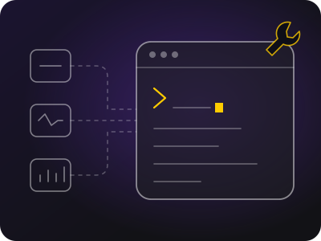

# TrueNAS homelab toolkit

<p align="center"></p>

[](https://github.com/EmaLau/truenas-homelab-toolkit/actions/workflows/ci.yml)
[](LICENSE)

Small scripts extracted from a running TrueNAS homelab, where they run every day. See the [changelog](CHANGELOG.md) and [the roadmap](ROADMAP.md).

A collection of small, independent scripts for running a TrueNAS SCALE / Community Edition box at home. Each one solves one problem and can be used on its own.

| Script | What it does | Runs from |
|---|---|---|
| [`lan-guard`](#lan-guard) | Blocks admin-only app ports from the home LAN, in IPv4 and IPv6, without touching SSH, the web UI or VPN access | init script + cron every 5 min |
| [`heartbeat`](#heartbeat) | Pings an external monitor every minute, so you get an alert when the NAS itself goes down; runs your own checks and notifies ntfy or a webhook when they change | cron every minute |
| [`storage-status`](#storage-status) | Writes pool health and usage, cloud storage usage, cloud sync results and snapshot age/size to one JSON file for dashboards, and optionally Prometheus metrics | cron every 30 min |
| [`system-backup`](#system-backup) | A nightly backup of the TrueNAS configuration, app settings, PostgreSQL and MariaDB databases and app folders, with checksums, retention and a verify script that restores the databases | cron nightly |

All scripts run as root from TrueNAS cron jobs or init scripts (System → Advanced). Keep them on a data pool, not on the boot pool.

## lan-guard

**Why.** A TrueNAS app is published on a host port, and Docker opens that port to every device on the LAN, ahead of any firewall rule you would normally write: Docker inserts its own rules and translates the address before `INPUT` ever sees the packet. Dashboards like Uptime Kuma, Scrutiny or Dozzle often have no login, or a weak one, so anything on the home network (a guest's phone, a smart TV, a compromised IoT device) can open them. Most people only reach these tools over a VPN anyway, so the LAN does not need them at all.

`lan-guard.sh` drops **new** connections that arrive on the LAN interface for a list of ports, while VPN (e.g. Tailscale), localhost, SSH and the TrueNAS UI keep working: it cannot lock you out.

- Docker DNATs published ports before filtering, so the rules live in `DOCKER-USER` and match the original port with conntrack; a second chain in `INPUT` covers connections that reach `docker-proxy` directly (e.g. over IPv6).
- Rules are rebuilt in a temporary chain and swapped, so there is never a moment without them.

```bash
cp lan-guard/lan-guard.conf.example lan-guard/lan-guard.conf   # set LAN_IF and PORTS
lan-guard.sh dry-run  # print the rules, change nothing (no root needed)
lan-guard.sh          # apply (idempotent)
lan-guard.sh status   # rules and hit counters
lan-guard.sh off      # remove everything
```

Ports must be numbers from 1 to 65535; anything else stops the script before it touches the firewall. Run `dry-run` first: it prints, in `iptables-save` syntax, exactly the rules `apply` would create.

Two optional settings in `lan-guard.conf`:

- **`ALLOW`**: LAN addresses that can still reach a blocked port, e.g. `ALLOW=("30002=192.168.1.20")` lets one desktop open the disk health UI. IPv4 or IPv6 addresses, optionally with a prefix (`192.168.1.0/28`); the port must be in `PORTS`, and host names are refused (they would be resolved only once, when the rule is created). Allowed connections leave the lan-guard chains with `RETURN` and continue through the normal Docker and INPUT rules.
- **`LOG_DROPS="yes"`**: every dropped connection is written to the kernel log with the prefix `lan-guard-drop:`, at most `LOG_LIMIT` lines (default `5/min`) per port and chain, so a scan cannot flood the log. Read them with `dmesg | grep lan-guard-drop` or `journalctl -k -g lan-guard-drop`.

Add it as a **post-init** script and as a cron job every 5 minutes: TrueNAS and Docker can rebuild their firewall rules.

Limits to know:

- **TCP only.** UDP ports stay reachable from the LAN.
- **IPv4 and IPv6.** If `ip6tables` is missing or IPv6 is disabled in the kernel, IPv6 is skipped with a warning on stderr.
- **The interface is matched by name.** If `LAN_IF` does not exist (typo, a new network card, a bridge created later), the rules match nothing and the ports are open again. `lan-guard.sh` and `lan-guard.sh status` warn when the interface is missing; the hit counters in `status` staying at 0 is another hint. Check `LAN_IF` after any network change (`ip -br link`).
- **Docker must use iptables.** The rules for containers live in `DOCKER-USER`, which Docker only uses with its default iptables firewall backend (on TrueNAS, `iptables` itself writes nftables rules, which is fine). If Docker is stopped, or switched to its nftables backend, nothing jumps to `DOCKER-USER` and published ports are open again: `lan-guard.sh` and `lan-guard.sh status` warn when `FORWARD` does not jump to `DOCKER-USER`.
- Test from a device on the LAN, not over the VPN: VPN traffic is not filtered by design.

## heartbeat

**Why.** A monitoring tool that runs on the NAS cannot tell you the NAS is down: when the box freezes, loses power or drops off the internet, it goes silent with everything else, and silence looks exactly like "all good". The check has to be turned around: the NAS proves it is alive every minute, and something *outside* raises the alarm when the proof stops arriving.

`heartbeat.sh` runs every minute from cron and has three independent parts, plus notifications. All are optional: a part without its settings is skipped.

```bash
cp heartbeat/heartbeat.conf.example heartbeat/heartbeat.conf
chmod 600 heartbeat/heartbeat.conf    # the URLs inside work as passwords
```

**1. NAS alive → Healthchecks.** Pings an external service such as [Healthchecks.io](https://healthchecks.io) (free plan, or self-hosted elsewhere). When the NAS shuts down or loses internet, the pings stop and Healthchecks alerts you, from outside the NAS. Set `HEALTHCHECKS_URL` to the check's ping URL and the check period to 1 minute. Any service that takes a plain GET as a heartbeat works the same way (for example an Uptime Kuma push URL on another machine).

**2. Tailscale state → Uptime Kuma.** Pushes `up` or `down` to an Uptime Kuma *push* monitor, depending on whether the Tailscale container reports `Running`. Useful when Tailscale is how you reach the NAS from outside. Set `KUMA_URL` (base address of Kuma) and `KUMA_TOKEN` (last part of the push URL); `TAILSCALE_CONTAINER` defaults to `ix-tailscale-tailscale-1`, the name TrueNAS gives the Tailscale app.

**3. Generic checks → Uptime Kuma.** `CHECKS` lists commands, one per entry, as `"NAME|KUMA_TOKEN|COMMAND"`. Each command runs with bash and a time limit (`CHECK_TIMEOUT`, default 20 s): exit code 0 is up, anything else (or a timeout) is down, and the first line of its output becomes the message. With a token, the result goes to its own Kuma push monitor, together with the time the command took; without one, the check only feeds the notifications.

```bash
CHECKS=(
  "pools|<kuma-token>|zpool status -x | grep -q 'all pools are healthy'"
  "nextcloud||curl -fsS -m 5 -o /dev/null http://127.0.0.1:30027/status.php"
)
```

**Notifications → ntfy or a webhook.** With `NOTIFY_URL` set, the Tailscale part and every check send one message when their state changes: when they go down and when they come back up, not every minute. The state is kept in a `state/` folder next to the script; on the first run only checks that are down notify. `NOTIFY_FORMAT=ntfy` (default) posts plain text with ntfy's title, tag and priority headers to a topic URL such as `https://ntfy.sh/<topic>`; `NOTIFY_FORMAT=json` posts `{"host", "check", "status", "msg", "time"}` to any webhook. `NOTIFY_TOKEN`, if set, is sent as `Authorization: Bearer <token>`. These only report checks: a NAS that is off cannot notify anything, which is what part 1 is for.

The script warns on stderr if `heartbeat.conf` is readable by other users, and exits with an error if no part is configured or a setting is invalid. Only one run at a time: if the previous one is still going (slow checks), the next one is skipped. A `PAUSE` file in the folder suspends it (e.g. during maintenance).

## storage-status

**Why.** The numbers that tell you a NAS is heading for trouble are spread across the TrueNAS UI: pool space on one page, scrub results and disk errors on another, snapshot tasks on a third, cloud space nowhere at all. Dashboards such as Homepage can show a JSON file, but should not hold an admin API key for TrueNAS or your cloud credentials. This script gathers everything as root, once every half hour, into one file that any dashboard or bot can read without credentials.

Collects, through the TrueNAS middleware (`midclt`), `zfs` and `rclone`:

- status, size and free space of every pool;
- pool health, the last scrub or resilver (state, errors, age) and every disk with its read, write and checksum error counters;
- used and free space of the cloud credentials that report it: **OneDrive and Google Drive** only, other providers are skipped;
- the last run of every cloud sync task: state (`SUCCESS`, `FAILED`, `RUNNING`…), start, end and error;
- space used by snapshots in every pool;
- for every dataset with a periodic snapshot task: number of snapshots, the newest one and its age, space used. Snapshots are matched with the task's naming schema, so manual snapshots are not counted.

```bash
cp storage-status/storage-status.conf.example storage-status/storage-status.conf   # optional
```

Settings, all optional, in `storage-status.conf` next to the script (or the file named by `$STORAGE_STATUS_CONF`); environment variables with the same names override them:

| Setting | Default | Meaning |
|---|---|---|
| `STORAGE_STATUS_OUT` | `/var/tmp/storage_status.json` | Where to write the JSON file |
| `PROMETHEUS_OUT` | empty (off) | Also write Prometheus metrics to this file |
| `WARN_PCT`, `CRIT_PCT` | `20`, `10` | Free space (percent) below which pools and cloud storage are `LOW` or `CRITICAL` |

The result is a single JSON file, written atomically, that a dashboard or a bot can read without credentials. Values are raw numbers (bytes, Unix timestamps, hours): formatting is up to the dashboard. The format is described by [`docs/storage-status.schema.json`](docs/storage-status.schema.json):

```json
{
 "schema_version": 1,
 "generated_at": "2026-11-19T16:31:30+01:00",
 "generated_epoch": 1795102290,
 "thresholds": {"warn_pct": 20, "crit_pct": 10},
 "errors": {},
 "pools": {
  "tank": {"status": "ONLINE", "size": 27986006900736, "free": 27234230513664, "used": 751776387072, "free_pct": 97,
           "space_status": "OK", "healthy": true,
           "scan": {"function": "SCRUB", "state": "FINISHED", "start": 1792879202, "end": 1792879863,
                    "errors": 0, "progress_pct": null, "age_hours": 619.67},
           "disks": [
            {"name": "sda", "role": "data", "status": "ONLINE", "read_errors": 0, "write_errors": 0, "checksum_errors": 0}
           ]}
 },
 "cloud": {
  "Microsoft OneDrive": {"id": 1, "provider": "onedrive", "status": "OK",
                         "total": 1239098064896, "used": 24910810317, "free": 1214187254579, "free_pct": 98}
 },
 "cloud_sync": {
  "Documents to OneDrive": {"id": 1, "credential": "Microsoft OneDrive", "direction": "PUSH", "enabled": true,
                            "state": "SUCCESS", "started": 1795064402, "finished": 1795064450, "age_hours": 10.5, "error": null}
 },
 "snapshot_space": {"tank": 8137539432, "boot-pool": 227655680},
 "snapshots": {
  "tank/data": {"tasks": [2, 3], "recursive": false, "count": 39, "bytes": 8136843792,
                "last": "auto-2026-11-19_02-00", "last_epoch": 1795050000, "age_hours": 14.53}
 }
}
```

ZFS keeps only the most recent scan of a pool, so `scan` is the last scrub *or* resilver. A full example, with a degraded pool during a resilver and an offline pool, is in [`tests/storage-status.example.json`](tests/storage-status.example.json). New fields can be added without changing `schema_version`, which only goes up on incompatible changes.

Cloud status is `OK`, `LOW` (under `WARN_PCT` free), `CRITICAL` (under `CRIT_PCT`) or `ERROR` (with an `error` field); pools get the same levels in `space_status`.

**Errors.** Each section (`pools`, `cloud`, `cloud_sync`, `snapshots`) is collected on its own. If one fails (a middleware call times out, `zfs` errors), the file is still written with the other sections complete, the failed one is listed in `errors` with its message, and the script exits with status 1, so the cron job reports it.

**Prometheus.** With `PROMETHEUS_OUT` set, the same data is also written as gauges named `storage_status_*`, for node_exporter's *textfile* collector: point `PROMETHEUS_OUT` into the folder given to `--collector.textfile.directory`. For example `storage_status_pool_healthy{pool="tank"}`, `storage_status_disk_errors{pool,disk,type}`, `storage_status_cloudsync_success{task,id}`, `storage_status_snapshot_last_timestamp_seconds{dataset}` and `storage_status_section_ok{section}`.

**Cloud tokens.** To read the cloud space, the script passes the TrueNAS cloud credentials to `rclone about` through a temporary config file (mode 600, deleted afterwards). rclone refreshes OAuth tokens when they expire; like TrueNAS after a cloud sync, the script saves the refreshed token back to the credential (`cloudsync.credentials.update`), so the stored one never goes stale.

## system-backup

**Why.** The copies TrueNAS keeps of its own configuration stay on the NAS, so they are lost along with it, and a ZFS snapshot of a running database folder is not guaranteed to restore. A useful nightly backup has to dump the databases properly, save the TrueNAS config with its secret seed, and check that each piece can actually be read back. These two scripts do that, driven by one settings file.

```bash
cp system-backup/system-backup.conf.example system-backup/system-backup.conf
chmod 600 system-backup/system-backup.conf   # then set BACKUP_DIR and the parts you want
system-backup/system-backup.sh                       # nightly, from cron
system-backup/system-backup-verify.sh --restore      # e.g. weekly
```

`system-backup.sh` writes each backup to `BACKUP_DIR/YYYY-MM-DD_HH-MM-SS`, with only the parts you configure:

- **TrueNAS configuration** (`config.save`) with the secret seed, checked to contain both the database and the seed: without the seed, a restored configuration loses every stored password;
- **app settings**: `app.query` and the `app.config` of the chosen apps, or of every app with `APP_CONFIGS=("*")`;
- **PostgreSQL** databases running in app containers: `pg_dump -Fc` in one transaction, checked with `pg_restore --list`, plus the roles;
- **MariaDB/MySQL** databases: `mariadb-dump` or `mysqldump` with `--single-transaction`, gzipped, checked for the end-of-dump marker. The password is read inside the container from its own environment, never from the host's command line;
- **folder archives**, one `tar.gz` per entry, each with its own list of apps to stop. Apps are stopped only while their own archive is made, only if they were running, and are started again even when the backup fails. Archives without apps are read live; paths can be optional (`?/path`), excluded (tar patterns) or required.

Work happens in an `.incomplete-*` folder renamed only at the end, so a half-made backup never looks complete. Every backup gets a `manifest.json` and `SHA256SUMS`; `BACKUP_DIR/latest` points to the newest one, and `status/last_run.json` and `status/last_success.json` describe the last run for dashboards. Retention keeps every backup of the last `KEEP_DAILY` days, then the first backup of each of the last `KEEP_MONTHLY` months; a folder containing `.keep` is never removed. Only one backup runs at a time.

For alerts, `HEALTHCHECKS_URL` gets a ping at the start, on success and on failure (so a backup that never ran is noticed too), and `NOTIFY_URL` gets an ntfy or JSON message on failure, or always with `NOTIFY_ON="always"`, as in heartbeat. Without the TrueNAS parts (`TRUENAS_CONFIG="no"`, no app settings, no apps to stop) the script also runs on any Linux machine with Docker.

**Verifying.** A backup that was never restored is a hope. `system-backup-verify.sh [--restore] [FOLDER]` (default: the latest backup) checks the checksums and the manifest, opens the TrueNAS configuration database and runs SQLite's integrity check, reads every archive to the end and checks the format of every dump. With `--restore`, each database is restored into a throwaway container without network (`PG_IMAGE`, `MYSQL_IMAGE`: at least the version of your databases) and its tables are counted. Nothing else is changed; the result goes to `status/last_verify.json`, and failures are notified.

`examples/system-backup.sh` is the original script these came from, kept as a reference: it is tied to one homelab and includes app-specific logic (waiting for one app to be idle before stopping it, Telegram notifications).

## Tests

`tests/system-backup-test.sh` runs system-backup and system-backup-verify with fake `midclt` and `curl` (configuration, app settings, stopping and restarting apps, failures, retention, the lock); `tests/system-backup-restore-test.sh` backs up real PostgreSQL 16 and MariaDB 11 containers and restores the dumps with `--restore` (needs Docker):

```bash
bash tests/system-backup-test.sh
bash tests/system-backup-restore-test.sh
```

`tests/heartbeat-test.sh` runs heartbeat with fake `curl` and `docker` commands (nothing is sent anywhere) and checks the pushes, the checks, the notifications and the lock. It needs bash 5, GNU `timeout`, `flock` and python3, as on TrueNAS:

```bash
bash tests/heartbeat-test.sh
```

`tests/storage-status-test.py` runs storage-status against fake `midclt`, `zfs` and `rclone` commands that answer from `tests/storage-status.fixtures.json` (invented data, shaped like TrueNAS 25.10), and checks the JSON, the Prometheus file, the error handling and the settings:

```bash
python3 tests/storage-status-test.py
```

`tests/lan-guard-test.sh` checks lan-guard against a real firewall inside a throwaway container (it refuses to run anywhere else):

```bash
docker run --rm --cap-add NET_ADMIN -v "$PWD":/src:ro alpine:3.20 \
  sh -c 'apk add -q iptables ip6tables bash && bash /src/tests/lan-guard-test.sh'
```

## Roadmap

Planned features are in [ROADMAP.md](ROADMAP.md).

## License

[MIT](LICENSE). Changes are listed in the [changelog](CHANGELOG.md).
